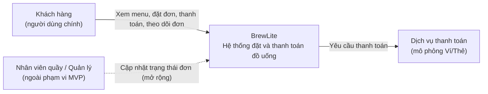
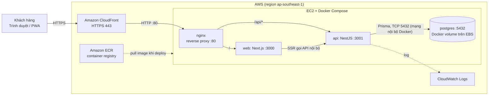

# Kiến trúc hệ thống BrewLite (Task 3.1)

| Mục | Nội dung |
|---|---|
| Phiên bản | 1.0 |
| Ngày | 2026-11-03 |
| Phương pháp trình bày | C4 (Context, Container) kết hợp kiến trúc phân lớp bên trong backend |
| Tài liệu liên quan | `docs/requirements/`, `docs/diagrams/`, `docs/architecture/adr/`, `docs/deployment.md` |

## 1. Mục tiêu và các yếu tố chi phối kiến trúc

Kiến trúc được chọn để thỏa mãn luồng nghiệp vụ tối thiểu: **Xem menu → Chọn tùy chọn → Giỏ hàng → Đặt đơn → Thanh toán → Theo dõi đơn**.

| Yếu tố chi phối | Ảnh hưởng đến kiến trúc |
|---|---|
| Ràng buộc công nghệ: Next.js, NestJS, PostgreSQL, Docker | Ba thành phần chính được cố định; mọi thành phần khác chỉ bổ sung |
| Triển khai production trên AWS (yêu cầu của giảng viên) | Chọn tổ hợp dịch vụ AWS đơn giản, đủ HTTPS, registry, log, health check (ADR-006) |
| NFR hiệu năng: API phản hồi < 500 ms với dữ liệu mẫu | Một DB duy nhất, truy vấn qua index, không có bước gọi mạng thừa |
| NFR bảo mật: băm mật khẩu, JWT, validate đầu vào, secret không nằm trong repo | Guard JWT, ValidationPipe, quản lý secret tách khỏi mã nguồn (ADR-004) |
| Tính đúng đắn nghiệp vụ: không bán quá tồn kho, không thanh toán hai lần | Transaction, khóa lạc quan, Idempotency-Key, state machine (ADR-005) |
| Khả năng triển khai và truy vết | Đóng gói Docker, CI/CD tự động, tag image theo commit SHA (ADR-007) |
| Nguồn lực: nhóm nhỏ, thời gian ngắn | Ưu tiên giải pháp đơn giản, ít thành phần vận hành (modular monolith, một máy chủ) |

> Khi đối chiếu với SRS, ghi thêm mã NFR tương ứng vào cột bên trái của bảng này.

## 2. C4 – Mức 1: System Context

- Dịch vụ thanh toán là **mô phỏng**, nằm sau một interface để có thể thay bằng cổng thật (Momo/VNPay/Stripe) mà không đổi nghiệp vụ.
- Nhân viên quầy và quản lý nằm ngoài MVP; trạng thái `PREPARING`, `READY`, `COMPLETED` vẫn được mô hình hóa trong state machine để mở rộng.

## 3. C4 – Mức 2: Container

| Container | Công nghệ | Trách nhiệm | Mã nguồn |
|---|---|---|---|
| Web client (PWA) | Next.js, React, TypeScript, TailwindCSS, Zustand | Giao diện mobile-first, giỏ hàng phía client, gọi REST API | `apps/web` |
| API | NestJS, TypeScript, class-validator, Passport JWT, Prisma | Nghiệp vụ: sản phẩm, xác thực, đơn hàng, thanh toán, khuyến mãi, điểm thưởng | `apps/api` |
| Database | PostgreSQL 16 | Lưu dữ liệu bền vững; không mở cổng ra Internet | `apps/api/prisma` (schema, migration, seed) |
| Reverse proxy | nginx | Một điểm vào duy nhất: `/` → web, `/api/*` → api | `nginx/default.conf` |
| CDN | Amazon CloudFront | HTTPS cho người dùng, phân phối nội dung tĩnh của Next.js, chuyển tiếp `/api/*` không cache | Cấu hình AWS, ghi trong `docs/deployment.md` |

Frontend và API cùng một tên miền (đường dẫn `/api`), nên không phát sinh CORS giữa hai thành phần trong production.

## 4. Kiến trúc frontend (Next.js / PWA)

- **Mobile-first:** TailwindCSS, bố cục theo wireframe 5 màn hình (Menu, Chi tiết, Giỏ hàng, Thanh toán, Xác nhận).
- **PWA:** có `manifest.webmanifest` và service worker cache phần vỏ ứng dụng; dữ liệu đơn hàng luôn lấy trực tuyến.
- **Trạng thái:** giỏ hàng lưu bằng Zustand (kèm `localStorage`); dữ liệu từ API quản lý bằng React Query (loading/empty/error rõ ràng).
- **Xác thực:** token JWT gắn vào header `Authorization: Bearer`; route đặt đơn và lịch sử đơn yêu cầu đăng nhập.
- **Thanh toán:** client sinh `Idempotency-Key` (UUID) cho mỗi lần xác nhận thanh toán và gửi lại cùng key khi retry.
- **Validate:** kiểm tra cơ bản ở form (kiểu, bắt buộc), nhưng backend mới là nơi quyết định.

## 5. Kiến trúc backend (NestJS theo module/domain)

Phân lớp trong mỗi module: **Controller → Service (nghiệp vụ) → Repository/Prisma**. Controller không chứa nghiệp vụ.

| Module | Trách nhiệm | Endpoint chính |
|---|---|---|
| `auth` | Đăng ký, đăng nhập, băm mật khẩu bcrypt, phát JWT, `JwtAuthGuard` | `POST /auth/register`, `POST /auth/login` |
| `users` | Thông tin người dùng, điểm tích lũy | (nội bộ) |
| `products` | Menu, chi tiết, size/topping, tồn kho | `GET /products`, `GET /products/:id` |
| `orders` | Tạo đơn, tính tiền phía server, state machine, lịch sử đơn | `POST /orders`, `GET /orders/me` |
| `payments` | Thanh toán qua `PaymentGateway`, kiểm tra idempotency | `POST /payments` |
| `promotions` | Kiểm tra và áp mã giảm giá | (gọi từ `orders`) |
| `loyalty` | Ghi `LoyaltyTransaction`, cộng điểm sau khi đơn `PAID` | (gọi từ `payments`) |
| `health` | Kiểm tra sống và kết nối DB | `GET /health` |
| `common` | Pipe validate, exception filter, logging interceptor, cấu hình | – |

Các quyết định nghiệp vụ quan trọng:

- **State machine đơn hàng:** `PENDING → PAID → PREPARING → READY → COMPLETED`; nhánh `PAYMENT_FAILED` (được thử lại) và `CANCELLED`. Hàm `assertTransition` chặn chuyển trạng thái không hợp lệ.
- **Tạo đơn và trừ tồn kho trong một transaction:** cập nhật có điều kiện (`WHERE stock >= qty AND version = ?`) để hai khách đặt đồng thời không vượt tồn kho; thất bại thì rollback toàn bộ.
- **Thanh toán idempotent:** bảng `Payment` có ràng buộc duy nhất trên `idempotencyKey`; cùng key gửi lại trả về kết quả cũ, không tạo đơn hoặc giao dịch thứ hai.
- **Tính tiền ở server:** server tự tính `lineTotal` và `total` từ giá trong DB, không tin giá client gửi lên.
- **Dịch vụ thanh toán mô phỏng:** `PaymentGateway` là interface; `MockPaymentGateway` trả thành công/thất bại theo quy tắc cấu hình được (dùng để test cả hai nhánh).

## 6. Dữ liệu, migration và seed

- PostgreSQL 16; truy cập qua Prisma. Mô hình dữ liệu bám theo class diagram: `User`, `Product`, `Order`, `OrderItem`, `Payment`, `Promotion`, `LoyaltyTransaction`.
- **Migration:** `prisma migrate dev` ở local; `prisma migrate deploy` ở production, chạy như một bước riêng trước khi khởi động API phiên bản mới. Migration viết theo hướng tương thích ngược để rollback ứng dụng không cần rollback DB.
- **Seed:** `prisma db seed` tạo menu mẫu, tài khoản mẫu, mã khuyến mãi mẫu; chạy lại được.
- **Sao lưu:** `pg_dump` trước mỗi lần migrate ở production (xem `docs/deployment.md`).

## 7. Luồng xử lý chính

Luồng đặt và thanh toán được mô tả đầy đủ trong `docs/diagrams/sequence-checkout.puml`. Tóm tắt: Client gửi `POST /orders` kèm JWT → API xác thực, validate, mở transaction tạo đơn `PENDING` và trừ tồn kho → Client gửi `POST /payments` kèm `Idempotency-Key` → API gọi `PaymentGateway` → thành công: đơn `PAID`, cộng điểm; thất bại: đơn `PAYMENT_FAILED`, giỏ hàng giữ nguyên.

## 8. Các mối quan tâm xuyên suốt

| Chủ đề | Giải pháp |
|---|---|
| Logging | NestJS Logger xuất JSON ra stdout (kèm request id); Docker logging driver `awslogs` đẩy lên CloudWatch Logs. Không ghi mật khẩu, token, Idempotency-Key đầy đủ vào log |
| Health check | `GET /health` trả trạng thái API và kiểm tra kết nối DB; dùng cho `HEALTHCHECK` của Docker và smoke test sau deploy |
| Cấu hình | `@nestjs/config`, kiểm tra biến môi trường khi khởi động (thiếu biến thì không chạy); `.env.example` liệt kê đủ biến, không chứa giá trị thật |
| Secret | Local: `.env` (đã nằm trong `.gitignore`). CI: GitHub Actions Secrets. Production: file `.env` trên EC2 quyền 600, không đưa vào image |
| Bảo mật | bcrypt, JWT hết hạn ngắn, `ValidationPipe` (whitelist), helmet, giới hạn tốc độ cho `/auth/*`, DB không public |
| Xử lý lỗi | Exception filter trả định dạng lỗi thống nhất; mã HTTP đúng ngữ nghĩa (400, 401, 404, 409 cho hết hàng/xung đột, 422...) |

## 9. Môi trường và triển khai

Ba ranh giới môi trường:

| Môi trường | Thành phần | Mục đích |
|---|---|---|
| Local | Máy dev, `docker-compose.yml` (web, api, postgres) | Phát triển và chạy thử |
| CI | GitHub Actions, GitHub Secrets | Lint, test, build, build image, push ECR, ra lệnh deploy |
| Production | AWS: CloudFront, EC2 (Docker Compose), ECR, CloudWatch | Phiên bản chạy thật cho người dùng |

**Truy vết deployment diagram:** mỗi node trong sơ đồ triển khai phải tên trùng với bảng dưới đây.

| Node trong deployment diagram | Thành phần kiến trúc | Mã nguồn / cấu hình |
|---|---|---|
| Thiết bị người dùng (Browser/PWA) | Web client (mục 4) | `apps/web` |
| Amazon CloudFront | CDN/HTTPS (mục 3) | Cấu hình AWS, `docs/deployment.md` |
| EC2 instance (Docker Engine) | Máy chủ chạy container | `docker-compose.prod.yml`, `docs/deployment.md` |
| Container nginx | Reverse proxy | `nginx/default.conf` |
| Container web (Next.js) | Web client (mục 4) | `apps/web/Dockerfile` |
| Container api (NestJS) | Backend (mục 5) | `apps/api/Dockerfile` |
| Container postgres + Docker volume (EBS) | Dữ liệu (mục 6) | `docker-compose.prod.yml`, `apps/api/prisma` |
| Amazon ECR | Container registry | `.github/workflows/deploy.yml` |
| GitHub Actions | CI/CD (ADR-007) | `.github/workflows/ci.yml`, `deploy.yml` |
| GitHub Secrets | Secret của CI | Không nằm trong repository |
| Tệp `.env` trên EC2 | Secret/cấu hình runtime | Mẫu: `.env.example` |
| AWS Systems Manager (Run Command) | Kênh deploy từ CI vào EC2 | `.github/workflows/deploy.yml` |
| Amazon CloudWatch Logs | Logging (mục 8) | Cấu hình `logging` trong `docker-compose.prod.yml` |

Cổng và giao thức: người dùng → CloudFront **HTTPS 443**; CloudFront → nginx **HTTP 80** (Security Group chỉ cho phép dải IP của CloudFront); nginx → web **3000**, api **3001** (mạng nội bộ Docker); api → postgres **5432** (mạng nội bộ Docker, không map ra host). Không mở cổng 22.

## 10. Lý do chọn, ưu điểm, hạn chế và trade-off

| Quyết định | Ưu điểm | Hạn chế | Trade-off đã chấp nhận |
|---|---|---|---|
| Modular monolith (NestJS) thay vì microservices | Đơn giản, dễ test, một lần deploy, transaction DB nguyên vẹn | Mở rộng theo từng module khó hơn | Nhóm nhỏ và thời gian ngắn, nghiệp vụ cần transaction chặt (đơn + tồn kho) |
| Monorepo, hai package độc lập | Một repo, một lịch sử, tài liệu và code cùng chỗ | Không có công cụ build chung | Không dùng Nx/Turborepo để giảm độ phức tạp |
| PostgreSQL + Prisma | Kiểu an toàn, migration rõ ràng, seed tái tạo được | Prisma bó buộc một số truy vấn phức tạp | Chấp nhận dùng truy vấn thô (raw) ở chỗ khóa lạc quan nếu cần |
| Một EC2 chạy Docker Compose | Rẻ, dễ hiểu, giống môi trường local | Một điểm lỗi duy nhất, không tự mở rộng | Đổi lấy tốc độ triển khai; xem phương án ECS/RDS trong ADR-006 |
| PostgreSQL chạy trong container (volume trên EBS) | Không cần cấu hình mạng riêng cho RDS, rẻ | Sao lưu, vá lỗi, HA do nhóm tự lo | Có `pg_dump` trước migrate; nêu RDS là hướng nâng cấp |
| CloudFront phía trước | HTTPS miễn tên miền riêng, CDN cho nội dung tĩnh | Đoạn CloudFront → EC2 là HTTP | Giới hạn Security Group theo dải IP CloudFront và dùng header bí mật xác thực nguồn |
| JWT lưu phía client, không có refresh token | Đơn giản, đủ cho MVP | Rủi ro XSS đánh cắp token; hết hạn thì phải đăng nhập lại | Token sống ngắn, CSP và helmet, nêu cookie HttpOnly là hướng nâng cấp |

## 11. Rủi ro kiến trúc và giảm thiểu

| Rủi ro | Giảm thiểu |
|---|---|
| EC2 hỏng làm mất dịch vụ và dữ liệu | Snapshot EBS, `pg_dump` định kỳ lưu ra S3 hoặc ngoài máy; tài liệu khôi phục trong `docs/deployment.md` |
| Lộ secret qua repo hoặc log | `.gitignore`, `.env.example`, GitHub Secrets, quét log CI, không in biến môi trường |
| Máy EC2 thiếu RAM | Chọn cấu hình tối thiểu 2 GB RAM; build image ở CI, không build trên EC2 |
| Chi phí AWS vượt dự kiến | Đặt AWS Budget cảnh báo, tắt tài nguyên không dùng sau khi chấm |
| Migration lỗi làm hỏng DB | Sao lưu trước migrate, migration tương thích ngược, smoke test sau deploy |
| Triển khai thất bại | Pipeline dừng và có workflow rollback về tag image trước đó |

## 12. Danh sách ADR

| ADR | Quyết định |
|---|---|
| [001](adr/001-monorepo.md) | Monorepo với hai package độc lập |
| [002](adr/002-modular-monolith-nestjs-rest.md) | Modular monolith NestJS, giao tiếp REST/JSON |
| [003](adr/003-postgresql-prisma-migrations.md) | PostgreSQL với Prisma, migration và seed |
| [004](adr/004-jwt-authentication.md) | Xác thực bằng JWT và bcrypt |
| [005](adr/005-mock-payment-idempotency-transactions.md) | Thanh toán mô phỏng, idempotency, transaction |
| [006](adr/006-aws-deployment-topology.md) | Mô hình triển khai trên AWS |
| [007](adr/007-cicd-github-actions.md) | CI/CD bằng GitHub Actions |
