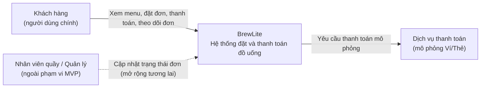
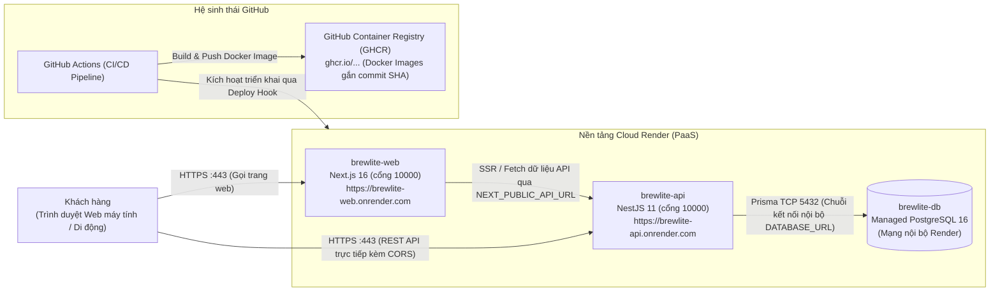

# Kiến trúc hệ thống BrewLite (Task 3.1)

| Mục | Nội dung |
|---|---|
| Phiên bản | 2.0 (Đồng bộ Hợp đồng API & Triển khai Render) |
| Ngày | 2026-11-10 |
| Phương pháp trình bày | C4 (Context, Container) kết hợp kiến trúc phân lớp bên trong backend |
| Tài liệu liên quan | `docs/requirements/`, `docs/diagrams/`, `docs/architecture/adr/`, `docs/deployment.md`, `docs/api-contract.md` |

---

## 1. Mục tiêu và các yếu tố chi phối kiến trúc

Kiến trúc được chọn để thỏa mãn luồng nghiệp vụ tối thiểu: **Xem menu → Chọn tùy chọn → Giỏ hàng → Đặt đơn → Thanh toán → Theo dõi đơn**.

| Yếu tố chi phối | Ảnh hưởng đến kiến trúc |
|---|---|
| Ràng buộc công nghệ: Next.js, NestJS, PostgreSQL, Docker | Ba thành phần chính được cố định; giao tiếp qua REST API độc lập. |
| Triển khai production trên Render (theo ADR-009, thay thế ADR-006) | Sử dụng PaaS Render quản lý qua Blueprint `render.yaml`, có HTTPS tự động, database an toàn, tự động hóa CI/CD qua GHCR và Render Deploy Hook. |
| NFR hiệu năng: API phản hồi < 500 ms với dữ liệu mẫu | Một DB duy nhất, truy vấn qua index, không có bước gọi mạng trung gian thừa. |
| NFR bảo mật: băm mật khẩu, JWT 24 giờ, validate đầu vào, secret ngoài repo | Guard JWT, ValidationPipe, mật khẩu băm bcrypt, token JWT có hiệu lực 24 giờ, quản lý secret tách rời khỏi mã nguồn (ADR-004). |
| Tính đúng đắn nghiệp vụ: không bán quá kho, chống thanh toán hai lần | Transaction ACID trừ kho có điều kiện `stock >= tổng số lượng cần`, Idempotency-Key theo từng người dùng, state machine (ADR-005). |
| Khả năng triển khai và truy vết | Đóng gói Docker, CI/CD tự động qua GitHub Actions, đẩy image gắn commit SHA lên GitHub Container Registry (ADR-007). |
| Nguồn lực: nhóm nhỏ, thời gian ngắn | Ưu tiên giải pháp đơn giản, chuẩn hóa, không dùng microservices hay framework quản lý state phức tạp. |

---

## 2. C4 – Mức 1: System Context

- Dịch vụ thanh toán là **mô phỏng**, nằm sau một interface (`PaymentGateway`) để có thể thay bằng cổng thật (Momo/VNPay/ZaloPay) mà không làm thay đổi logic nghiệp vụ.
- Giao diện nhân viên quầy và quản lý nằm ngoài MVP hiện tại; các trạng thái `PREPARING`, `READY`, `COMPLETED` vẫn được mô hình hóa trong state machine để mở rộng sau này.

---

## 3. C4 – Mức 2: Container (Kiến trúc Render PaaS)

| Container / Dịch vụ | Công nghệ | Trách nhiệm | Mã nguồn / Quản lý |
|---|---|---|---|
| `brewlite-web` | Next.js 16, React 19, TypeScript, Tailwind CSS v4 | Giao diện desktop-first, giỏ hàng localStorage, gọi REST API trực tiếp | `apps/web` |
| `brewlite-api` | NestJS 11, TypeScript, class-validator, Passport JWT, Prisma | Nghiệp vụ: sản phẩm, xác thực, đơn hàng, thanh toán mô phỏng, health check | `apps/api` |
| `brewlite-db` | Render Managed PostgreSQL 16 | Lưu trữ dữ liệu an toàn, bền vững; mạng nội bộ bảo vệ dữ liệu | `apps/api/prisma` |
| `GHCR` | GitHub Container Registry (`ghcr.io`) | Lưu trữ Docker image được gắn nhãn commit SHA phục vụ truy vết | `.github/workflows/cd.yml` |

> **Cấu hình Tên miền và CORS:**
> Frontend và API sở hữu hai tên miền riêng biệt do Render cấp phát tự động có sẵn HTTPS (`brewlite-web.onrender.com` và `brewlite-api.onrender.com`).
> - Web gọi API trực tiếp qua domain của API thông qua biến môi trường `NEXT_PUBLIC_API_URL` được nung vào lúc build.
> - API cấu hình bật CORS qua biến môi trường `CORS_ORIGIN` trỏ chính xác về domain của Web để đảm bảo an toàn truy cập chéo nguồn.
> - Bỏ hoàn toàn tiền tố `/api` (API gọi thẳng các endpoint gốc: `/products`, `/orders`, `/payments`, `/auth/login`, `/health`).

---

## 4. Kiến trúc Frontend (Next.js App Router)

- **Ưu tiên màn hình máy tính (Desktop-first):** Thiết kế giao diện ưu tiên trải nghiệm trên máy tính theo yêu cầu đồ án, đồng thời áp dụng Tailwind CSS để đáp ứng responsive mượt mà trên thiết bị di động. Không triển khai PWA (không dùng Service Worker, không có manifest offline).
- **Quản lý trạng thái:**
  - Dữ liệu giỏ hàng được lưu trữ bền vững tại `localStorage` của trình duyệt thông qua React Context (`CartContext`). Giỏ hàng chỉ được gửi lên máy chủ khi khách hàng bấm Đặt đơn.
  - Không sử dụng các thư viện quản lý state nặng như Zustand hoặc React Query.
- **Trang theo dõi đơn hàng:** Trang theo dõi đơn hàng (`/orders/:id`) chỉ tải dữ liệu một lần khi người dùng mở trang hoặc khi bấm nút "Tải lại", tuyệt đối **không tự động polling mỗi 5 giây**.
- **Xác thực:** Lưu trữ mã `accessToken` (thời hạn 24 giờ) phía Client và gắn vào HTTP Header `Authorization: Bearer <accessToken>`. Khi gặp mã lỗi 401 Unauthorized, giao diện tự động điều hướng về màn hình đăng nhập.
- **Thanh toán:** Client sinh `Idempotency-Key` (chuỗi ngẫu nhiên từ 8-100 ký tự) cho mỗi lần xác nhận thanh toán. Khi thanh toán thất bại (`PAYMENT_FAILED`), nút "Thử lại thanh toán" sẽ tái sử dụng cùng đơn hàng đó và gửi kèm một `Idempotency-Key` **mới**.
- **Kiểm soát giá:** Giao diện chỉ tính toán giá tạm tính để hiển thị cho người dùng xem trước, tuyệt đối không gửi `unitPrice` hay `totalAmount` lên server.

---

## 5. Kiến trúc Backend (NestJS Modular Monolith)

Mỗi module tuân thủ cấu trúc phân lớp chặt chẽ: **Controller → Service (nghiệp vụ) → Repository / Prisma**. Controller chỉ làm nhiệm vụ validate đầu vào và điều hướng, không chứa logic nghiệp vụ.

| Module | Trách nhiệm | Endpoint chính |
|---|---|---|
| `auth` | Đăng ký, đăng nhập, băm mật khẩu bcrypt, phát JWT token 24 giờ, `JwtAuthGuard` | `POST /auth/register`, `POST /auth/login` |
| `products` | Menu danh mục, tìm kiếm, chi tiết món, cấu hình size/topping, tồn kho | `GET /products`, `GET /products/:id` |
| `orders` | Tạo đơn, tính tiền server, trừ kho ACID, máy trạng thái, lịch sử đơn | `POST /orders`, `GET /orders/me`, `GET /orders/:id` |
| `payments` | Cổng thanh toán mô phỏng (`PaymentGateway`), kiểm tra Idempotency theo user | `POST /payments` |
| `health` | Kiểm tra trạng thái sẵn sàng của dịch vụ API | `GET /health` |
| `prisma` | Quản lý kết nối PostgreSQL và thực thi Prisma Transaction | – |
| `common` | ValidationPipe toàn cục, Filter xử lý ngoại lệ chuẩn, Interceptor ghi log | – |
| `promotions` | *(Phạm vi mở rộng tương lai - Chưa hiện thực trong code)* | – |
| `loyalty` | *(Phạm vi mở rộng tương lai - Chưa hiện thực trong code)* | – |

### Các quyết định nghiệp vụ cốt lõi:

1. **Máy trạng thái đơn hàng (State Machine):**
   - Vòng đời: `PENDING` $\to$ `PAID` $\to$ `PREPARING` $\to$ `READY` $\to$ `COMPLETED`.
   - Nhánh phụ: `PAYMENT_FAILED` (cho phép thanh toán lại nhiều lần) và `CANCELLED`.
   - Hàm `validateTransition` chặn đứng mọi hành vi chuyển trạng thái trái phép.
2. **Tạo đơn và trừ tồn kho trong một Transaction (ACID):**
   - Bỏ hoàn toàn khóa lạc quan và cột `version`.
   - Toàn bộ quá trình tạo đơn và trừ tồn kho được gói gọn trong 1 Transaction với điều kiện `stock >= tổng số lượng cần` (được cộng gộp theo từng món). Nếu không đủ số lượng, giao dịch tự động hủy và trả về lỗi 409 Conflict kèm danh sách món thiếu.
3. **Thanh toán Idempotent theo từng người dùng:**
   - Khóa `Idempotency-Key` được phân biệt theo từng người dùng (`userId` + `idempotencyKey`).
   - Gửi lại cùng key và cùng `orderId` sẽ trả lại kết quả giao dịch cũ với mã HTTP 200 OK, đảm bảo không trừ tiền 2 lần.
4. **Server độc quyền tính giá:**
   - Server tự tính giá `unitPrice` và `totalAmount` dựa trên cơ sở dữ liệu (giá gốc + phụ thu size + tổng giá topping), không bao giờ tin cậy giá gửi từ client.
5. **Cổng thanh toán mô phỏng:**
   - Giả lập thất bại khi số tài khoản tận cùng `0000`, các số khác thành công. Chỉ lưu 4 số cuối (`accountLast4`), tuyệt đối không lưu và không ghi log số tài khoản đầy đủ.

---

## 6. Dữ liệu, Migration và Seed

- **Hệ quản trị CSDL:** PostgreSQL 16 quản trị qua Prisma ORM.
- **Mô hình dữ liệu hiện thực (7 bảng):** `User`, `Product`, `Topping`, `Order`, `OrderItem`, `OrderItemTopping`, `Payment`. *(Không tạo các bảng `Size`, `Promotion`, `LoyaltyTransaction`)*.
- **Quy trình Migration:**
   - Ở local: Chạy `npx prisma migrate dev`.
   - Ở production: Chạy `npx prisma migrate deploy` qua kết nối an toàn `RENDER_EXTERNAL_DATABASE_URL` từ CI/máy dev. Tách biệt hoàn toàn khỏi lúc khởi động container API (container chạy lệnh `node dist/main`).
- **Seed dữ liệu:**
   - File `prisma/seed.ts` sử dụng lệnh `upsert` theo đúng các mã ID cố định trong Hợp đồng API. Chạy seed nhiều lần không bao giờ bị nhân đôi dữ liệu.
   - Production tuyệt đối không nạp tài khoản demo, chỉ nạp 12 món ăn/uống và 4 loại topping mẫu.

---

## 7. Luồng xử lý chính (End-to-End Checkout)

Luồng nghiệp vụ hoàn chỉnh từ giỏ hàng đến xác nhận đơn hàng:
1. Client gửi `POST /orders` kèm token JWT $\to$ API xác thực, kiểm tra dữ liệu đầu vào, mở Transaction kiểm tra tồn kho cộng gộp và trừ kho $\to$ Trả về đơn hàng mới ở trạng thái `PENDING` với mã `orderNumber` tăng dần.
2. Client gửi `POST /payments` kèm header `Idempotency-Key` $\to$ API kiểm tra tính duy nhất của key theo người dùng $\to$ Gọi cổng thanh toán mô phỏng $\to$ 
   - Nếu tài khoản kết thúc `0000`: Đơn hàng chuyển sang `PAYMENT_FAILED`, lưu payment `FAILED`. Khách hàng có thể bấm "Thử lại thanh toán" với `Idempotency-Key` mới.
   - Nếu tài khoản hợp lệ: Đơn hàng chuyển sang `PAID`, lưu payment `SUCCESS`.
3. Client truy vấn chi tiết đơn `GET /orders/:id` để hiển thị màn hình xác nhận đơn và theo dõi trạng thái đơn hàng.

---

## 8. Các mối quan tâm xuyên suốt

| Chủ đề | Giải pháp |
|---|---|
| **Logging** | NestJS Logger xuất JSON ra stdout. Tuyệt đối không ghi mật khẩu, JWT token, hay số tài khoản đầy đủ vào log. |
| **Health check** | Endpoint `GET /health` kiểm tra tính sẵn sàng của API; phục vụ smoke test tự động và Docker health check. |
| **Cấu hình** | `@nestjs/config`, kiểm tra biến môi trường khi khởi động; file `.env.example` liệt kê đầy đủ biến mẫu. |
| **Quản lý Secret** | Secret không bao giờ đưa vào Git. Quản lý an toàn trên GitHub Actions Secrets và Render Dashboard Environment Variables. |
| **Bảo mật** | Băm mật khẩu bằng bcrypt, token JWT có hiệu lực 24 giờ, `ValidationPipe` whitelist loại bỏ trường thừa, database không mở cổng công khai tự do. |
| **Xử lý lỗi** | Filter ngoại lệ chuẩn hóa thông báo lỗi: validate đầu vào trả mảng chi tiết tiếng Anh, lỗi nghiệp vụ trả thông báo tiếng Việt theo đúng Hợp đồng API. |

---

## 9. Môi trường và Triển khai thực tế

Ba ranh giới môi trường được chuẩn hóa:

| Môi trường | Thành phần | Mục đích |
|---|---|---|
| **Local** | Máy dev cá nhân, `docker-compose.yml` (PostgreSQL), API cổng 3001, Web cổng 3000 | Phát triển, chạy thử và kiểm thử unit/integration |
| **CI/CD** | GitHub Actions (`ci.yml`, `cd.yml`, `rollback.yml`), GitHub Secrets, GHCR | Tự động hóa kiểm thử, đóng gói Docker image, chạy migration và deploy |
| **Production** | Render Cloud Platform: `brewlite-web`, `brewlite-api`, `brewlite-db` | Hệ thống triển khai thực tế công khai qua HTTPS |

### Bảng đối chiếu Node trong Deployment Diagram (Mục 9)

Mọi tên node trong sơ đồ triển khai (Deployment Diagram) được đồng bộ chính xác theo bảng dưới đây:

| Node trong Deployment Diagram | Thành phần kiến trúc thực tế | Cấu hình & Vị trí |
|---|---|---|
| `Thiết bị người dùng (Trình duyệt Web)` | Khách hàng truy cập máy tính / điện thoại | Giao diện Web Next.js |
| `Render PaaS (Nền tảng Cloud)` | Hạ tầng đám mây Render | Quản lý qua `render.yaml` |
| `brewlite-web (Web Service)` | Web Service Next.js 16 (cổng 10000, HTTPS) | `apps/web/Dockerfile`, `render.yaml` |
| `brewlite-api (Web Service)` | API Web Service NestJS 11 (cổng 10000, HTTPS) | `apps/api/Dockerfile`, `render.yaml` |
| `brewlite-db (Managed PostgreSQL 16)` | Database PostgreSQL được quản lý, mạng nội bộ | `render.yaml` |
| `GitHub Container Registry (GHCR)` | Registry lưu trữ image Docker gắn commit SHA | `ghcr.io/...`, `.github/workflows/cd.yml` |
| `GitHub Actions (CI/CD Pipeline)` | Tự động hóa kiểm thử và triển khai | `.github/workflows/cd.yml`, `rollback.yml` |
| `GitHub Secrets` | Quản lý secret của CI/CD (`RENDER_EXTERNAL_DATABASE_URL`, v.v.) | GitHub Repository Settings |
| `Biến môi trường trên Render Dashboard` | Secret và tham số runtime (`JWT_SECRET`, `CORS_ORIGIN`, v.v.) | Render Dashboard Service Environment |

---

## 10. Lý do chọn, ưu điểm, hạn chế và trade-off

| Quyết định | Ưu điểm | Hạn chế | Trade-off đã chấp nhận |
|---|---|---|---|
| **Modular monolith (NestJS)** thay vì microservices | Đơn giản, dễ kiểm thử, một lần deploy, transaction ACID nguyên vẹn | Khó mở rộng riêng lẻ từng module | Phù hợp năng lực nhóm nhỏ và thời hạn ngắn; nghiệp vụ cần transaction chặt. |
| **PaaS Render** thay vì tự dựng AWS EC2 / Nginx | Tự động cấp phát HTTPS, quản lý hạ tầng chuẩn qua Blueprint `render.yaml`, miễn phí | Gói Free có thời gian cold start khoảng 50 giây; DB tự hết hạn sau 30 ngày | Giảm gánh nặng vận hành máy chủ, tránh phức tạp thanh toán quốc tế trên AWS. |
| **GHCR (GitHub Container Registry)** thay vì Docker Hub | Tích hợp sẵn với GitHub Actions bằng `GITHUB_TOKEN`, không bị giới hạn lượt kéo | Yêu cầu chuẩn hóa tên repo chữ thường | Tự động hóa liền mạch trong cùng hệ sinh thái GitHub. |
| **PostgreSQL 16 + Prisma** | Kiểu dữ liệu an toàn, migration truy vết được trong Git, seed nạp lại an toàn | Prisma hạn chế một số truy vấn raw phức tạp | Không dùng cột version, kiểm tra tồn kho trực tiếp trong transaction. |
| **Desktop-first, không làm PWA** | Tối ưu hiển thị màn hình lớn theo yêu cầu giảng viên, giao diện rõ ràng | Không cài đặt thành app offline trên điện thoại | Tránh phức tạp Service Worker và đồng bộ dữ liệu ngoại tuyến. |
| **JWT 24 giờ không Refresh Token** | Đơn giản, tiện lợi cho khách dùng trong ngày, hoàn toàn stateless | Khó thu hồi token đơn lẻ trước 24 giờ | Chấp nhận đánh đổi để giữ kiến trúc tinh gọn đúng hợp đồng API. |

---

## 11. Rủi ro kiến trúc và giải pháp giảm thiểu

| Rủi ro | Giải pháp giảm thiểu |
|---|---|
| **Cold Start trên Render Free** | Cấu hình vòng lặp thử lại (retry loop) trong script Smoke Test và thông báo người dùng đợi 50s ở lần gọi đầu. |
| **Database gói Free hết hạn sau 30 ngày** | Định kỳ sao lưu dữ liệu hoặc nâng cấp gói trước khi hết hạn; tài liệu khôi phục ghi rõ trong `docs/deployment.md`. |
| **Lộ khóa bảo mật qua Git** | Tuyệt đối không commit file `.env`; lưu trữ an toàn trên GitHub Secrets và Render Dashboard. |
| **Lỗi schema làm hỏng database** | Tách riêng bước chạy migration qua CI; có sẵn quy trình rollback qua `npx prisma migrate resolve` hoặc workflow `rollback.yml`. |
| **Khách hàng thanh toán trùng lặp** | Bắt buộc gửi `Idempotency-Key` phân biệt theo user; replay key cũ trả 200 OK kết quả cũ mà không trừ thêm tiền. |

---

## 12. Danh sách ADR

| ADR | Tiêu đề quyết định | Trạng thái |
|---|---|---|
| [001](adr/001-monorepo.md) | Monorepo với hai package độc lập | Accepted |
| [002](adr/002-modular-monolith-nestjs-rest.md) | Modular monolith NestJS, giao tiếp REST/JSON | Accepted (Updated) |
| [003](adr/003-postgresql-prisma-migrations.md) | PostgreSQL với Prisma, migration và seed | Accepted (Updated) |
| [004](adr/004-jwt-authentication.md) | Xác thực bằng JWT 24 giờ và bcrypt | Accepted (Updated) |
| [005](adr/005-mock-payment-idempotency-transactions.md) | Thanh toán mô phỏng, Idempotency và Giao dịch ACID | Accepted (Updated) |
| [006](adr/006-aws-deployment-topology.md) | Mô hình triển khai trên AWS | Superseded by ADR-009 |
| [007](adr/007-cicd-github-actions.md) | CI/CD bằng GitHub Actions và Triển khai Render | Accepted (Updated) |
| [009](adr/009-render-deployment.md) | Mô hình triển khai trên Render PaaS | Accepted |
