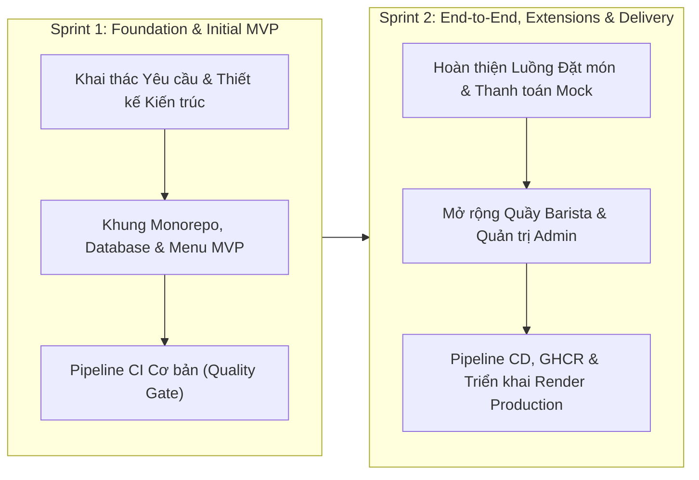
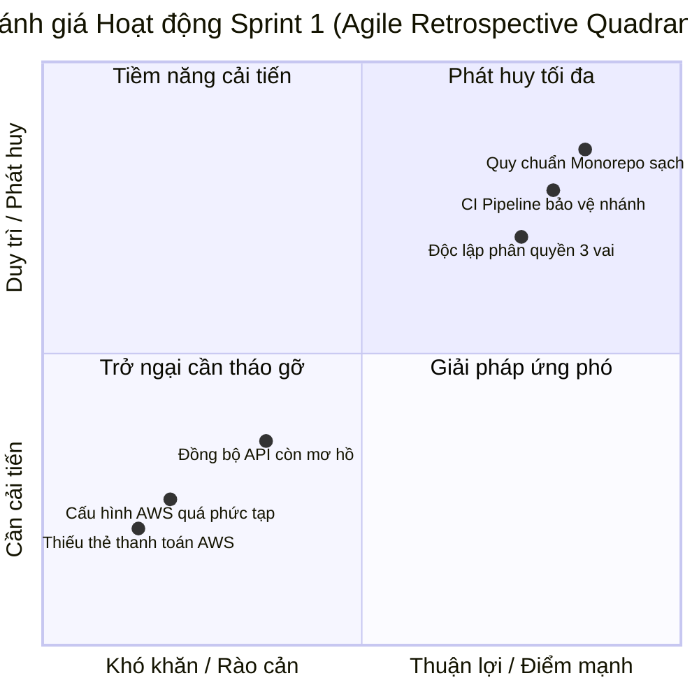

# 🔄 Sprint Review & Sprint Retrospective — Dự án BrewLite

**Học phần:** Công nghệ Phần mềm — Học kỳ I, Năm học 2026-2027  
**Đơn vị:** Trường Đại học Sài Gòn — Khoa Công nghệ Thông tin  
**Nhóm thực hiện:** Nhóm 12  
**Dự án:** BrewLite - Website đặt và thanh toán đồ uống trực tuyến tại quán  
**Tạo phẩm:** Báo cáo Tổng kết & Đánh giá Cải tiến Quy trình (Task 5.4 Delivery & Checklist 9.1)  
**Thời điểm hoàn thành:** 22/11/2026  

---

## 1. Tổng quan Dự án & Mô hình Phát triển

Dự án BrewLite được tổ chức theo phương pháp luận **Agile/Scrum rút gọn** trải qua 2 Sprint liên tục với sự phân chia vai trò rõ ràng và độc lập :
- **Frontend Developer (FE):** Phụ trách toàn bộ giao diện Next.js Desktop-first trong `apps/web/`, tối ưu hóa trải nghiệm khách hàng và nhân viên quầy.
- **Backend Developer (BE):** Phụ trách RESTful API NestJS trong `apps/api/`, cơ sở dữ liệu PostgreSQL 16, Prisma ORM, logic nghiệp vụ, transaction ACID và bảo mật phân quyền.
- **Dev&Ops / Technical Lead (DevOps):** Phụ trách kiến trúc hệ thống, Docker, CI/CD GitHub Actions, Container Registry (GHCR), hạ tầng đám mây Render PaaS, kiểm thử tự động (E2E & Smoke test), quản lý cấu hình và đồng bộ tài liệu bàn giao.

---

## 2. Sprint 1: Khởi tạo Nền tảng, Phân tích Thiết kế & MVP Đầu tiên

- **Thời gian thực hiện:** Tuần 1 - Tuần 2 (Sprint 1)
- **Sprint Goal:** Thiết lập môi trường monorepo độc lập, hoàn thiện tài liệu phân tích thiết kế (Task 1, 2, 3), xây dựng cơ sở dữ liệu nền tảng, thiết lập pipeline CI tự động và phát hành MVP ban đầu cho luồng xem menu.

### 2.1 Sprint Review 1 (Đánh giá Kết quả Bàn giao)

| Hạng mục cam kết (Sprint Backlog) | Kết quả bàn giao thực tế | Đánh giá |
|---|---|:---:|
| **Khảo sát yêu cầu (Task 1):** Bối cảnh, Stakeholders, SRS rút gọn, Đặc tả Use-case trọng tâm | Hoàn tất `context-and-scope.md`, `srs-task-1.2.md`, `use-case-đặc-tả-task 1.3.md`. Xác định rõ phạm vi In-Scope (Must) và Out-of-Scope (Won't). | **ĐẠT** |
| **Mô hình hóa hệ thống (Task 2):** Activity, Sequence, Class diagrams | Hoàn thành sơ đồ PlantUML và kết xuất ảnh đầy đủ cho Activity, Sequence và Class diagrams tại `docs/diagrams/`. | **ĐẠT** |
| **Thiết kế kiến trúc (Task 3):** Kiến trúc hệ thống, các quyết định ADR, Deployment diagram | Soạn thảo 6 ADR ban đầu, mô tả kiến trúc phân tầng Layered Architecture và Deployment Diagram. | **ĐẠT** |
| **Khung dự án & Môi trường local:** Docker Compose, NestJS API, Next.js Web | Cấu hình `docker-compose.yml` khởi chạy PostgreSQL 16; hai package `apps/api` và `apps/web` độc lập có `package.json` riêng; API chạy cổng 3001, Web chạy cổng 3000. | **ĐẠT** |
| **Cơ sở dữ liệu ban đầu:** Prisma schema, migration và seed menu | Tạo bảng `Product`, chạy migration thành công, nạp seed đủ 12 món ăn/uống phục vụ menu. | **ĐẠT** |
| **Tính năng MVP 1:** Xem menu, tìm kiếm, lọc danh mục | Giao diện Next.js hiển thị lưới sản phẩm, hỗ trợ tìm kiếm debounce, lọc theo 4 danh mục (`TEA`, `COFFEE`, `MILK_TEA`, `CAKE`), nhãn hết hàng, trạng thái loading/empty/error. | **ĐẠT** |
| **Tự động hóa CI (Task 4.4):** Pipeline kiểm tra tự động | Thiết lập `.github/workflows/ci.yml` chạy song song 2 job `api` và `web` kiểm tra `Install` → `Lint` → `Unit Test` → `Build` mỗi khi mở PR. | **ĐẠT** |

### 2.2 So khớp Definition of Done (DoD) Sprint 1
- [x] Mã nguồn biên dịch thành công không có cảnh báo lỗi nghiêm trọng.
- [x] Toàn bộ unit tests cho Product Module và Menu Component chạy qua (100% Pass).
- [x] Pipeline CI chạy trên GitHub Actions báo xanh cho Pull Request #32.
- [x] README gốc và README của từng ứng dụng ghi rõ cách cài đặt, chạy Docker và khởi động dev.

### 2.3 Sprint Retrospective 1 (Đánh giá Cải tiến Quy trình)

#### 1. Điều đã làm tốt (What Went Well):
- Thiết lập cấu trúc monorepo phân tách rõ ràng giữa frontend và backend mà không bị phụ thuộc vào các công cụ quản lý phức tạp (Turborepo/Nx), giúp các thành viên dễ làm quen.
- Thiết lập quy ước Git chặt chẽ (`quy-uoc-git.md`): Phân chia nhánh riêng `feature/frontend`, `feature/backend`, `feature/devops` và ghép vào nhánh chung `some-diagram-and-SRS` qua Pull Request có CI bảo vệ.
- Pipeline CI hoạt động ổn định, phát hiện ngay các lỗi linting và test trước khi code được merge.

#### 2. Điều chưa tốt & Khó khăn gặp phải (What Didn't Go Well):

- **Sự thiếu đồng bộ ban đầu giữa FE và BE:** Một số định dạng dữ liệu trả về giữa API và giao diện web chưa khớp hoàn toàn do thiếu một bản hợp đồng API chi tiết, dẫn đến việc phải sửa đổi code nhiều lần.

#### 3. Bài học kinh nghiệm & Hành động Cải tiến cho Sprint 2 (Action Items):
- **Hành động 1 (Thay đổi Hạ tầng):** Báo cáo giảng viên và ban hành [ADR-009](file:///e:/CNPM/BrewLite-CNPM-nh-m-12/docs/architecture/adr/009-render-deployment.md), chính thức chuyển đổi hạ tầng triển khai sang **PaaS Render** và Docker Registry sang **GitHub Container Registry (GHCR)**. Giải pháp này giúp tự động hóa HTTPS, quản lý hạ tầng chuẩn qua Blueprint `render.yaml` và loại bỏ hoàn toàn chi phí thẻ quốc tế.
- **Hành động 2 (Đóng băng Hợp đồng API):** Ban hành Hợp đồng API chuẩn hóa (18 endpoint chi tiết) và quy tắc `AGENTS.md` làm "nguồn sự thật duy nhất" (Single Source of Truth) để FE và BE phát triển song song mà không bị xung đột.

---

## 3. Sprint 2: Hoàn thiện MVP, Mở rộng Quầy/Quản trị, CI/CD & Bàn giao Production

- **Thời gian thực hiện:** Tuần 3 - Tuần 4 (Sprint 2)
- **Sprint Goal:** Hoàn thiện luồng người dùng trọn vẹn từ đặt món đến thanh toán và theo dõi đơn; mở rộng giao diện nhân viên quầy (`/staff`) và quản trị viên (`/staff/products`, `/staff/employees`); tự động hóa pipeline CD đóng gói Docker image, an toàn dữ liệu và triển khai trực tiếp lên Render Production kèm cơ chế Rollback.

### 3.1 Sprint Review 2 (Đánh giá Kết quả Bàn giao)

| Phân hệ / Nghiệp vụ | Chi tiết tính năng hiện thực | Trạng thái nghiệm thu |
|---|---|:---:|
| **Khách hàng (Customer E2E):** | • Xem chi tiết món tùy biến Size (S/M/L), Đường, Đá, 4 loại Topping. • Giỏ hàng lưu LocalStorage, tự tính tiền tạm tính. • Đăng ký, đăng nhập tài khoản, băm bcrypt, cấp JWT 24h. • Đặt đơn hàng trừ kho an toàn bằng Transaction ACID. • Thanh toán QR mô phỏng (ZaloPay/MoMo) có countdown 5s, cơ chế chống trừ tiền kép bằng `Idempotency-Key`, hỗ trợ thanh toán lại cho đơn lỗi đuôi `0000`. • Xem lịch sử đơn hàng cá nhân (`GET /orders/me`) và khách tự hủy đơn chờ. | **100% HOÀN THÀNH** *(Đạt tiêu chí Task 5.1)* |
| **Nhân viên Quầy (Barista):** | • Màn hình Bảng điều khiển Barista (`/staff`) nhận đơn thời gian thực. • Cập nhật các mốc trạng thái chuẩn: `PAID → PREPARING → READY → COMPLETED`. • Hủy đơn tại quầy khi có sự cố thiếu nguyên liệu. • Gạt nhanh trạng thái món "Đang bán" (`stock = 999`) / "Tạm hết" (`stock = 0`). | **100% HOÀN THÀNH** *(Mở rộng vượt MVP ban đầu)* |
| **Quản trị viên (Admin):** | • Màn hình Quản lý Sản phẩm (`/staff/products`): Thêm món mới, cập nhật giá, chỉnh sửa danh mục, ẩn/hiện món. • Màn hình Quản lý Nhân sự (`/staff/employees`): Xem danh sách nhân viên, bật/tắt khóa tài khoản nhân viên (trả mã lỗi 403 khi bị khóa). | **100% HOÀN THÀNH** *(Mở rộng đáp ứng SRS FR-08, FR-10)* |
| **Tự động hóa CD (Task 5.3):** | Pipeline CD `.github/workflows/cd.yml` hoàn chỉnh 5 bước: 1. *Quality Gate:* Lint, Unit Test, Build độc lập API & Web. 2. *Docker Registry:* Đóng gói image gắn commit SHA & semantic version, đẩy lên GHCR. 3. *Database Migration:* Chạy `prisma migrate deploy` an toàn qua CI secret. 4. *Deploy Render:* Kích hoạt Deploy Hook cho API và Web. 5. *Smoke Test:* Tự động gọi `/health` và trang chủ có retry hỗ trợ cold-start. | **100% HOÀN THÀNH** *(Đạt tiêu chí Task 5.3)* |
| **Cơ chế Rollback:** | Hỗ trợ 2 phương án: Hoàn nguyên 1-click trên Render Dashboard và workflow thủ công `.github/workflows/rollback.yml` có nhật ký ghi nhận nguyên nhân sự cố. | **100% HOÀN THÀNH** |
| **Kiểm thử Đa tầng:** | • 58 Backend Unit Tests (Jest) đạt 100% Pass. • 8 Frontend Test Suites (Testing Library) đạt 100% Pass. • 3 Integration Tests cho Auth, Orders, Payments. • 16 kịch bản End-to-End Test (`tests/e2e-order-flow.test.mjs`) kiểm tra trọn vẹn luồng thực tế. • Kịch bản Smoke Test tự động (`tests/smoke-test.ps1`). | **100% HOÀN THÀNH** *(Đạt tiêu chí Task 5.2 & 5.4)* |
| **Hồ sơ Bàn giao & Nghiệm thu:** | • Video Demo hệ thống độ phân giải cao trên [Google Drive](https://drive.google.com/file/d/1ee_Dqq-_FKyyMiGw4DBG6gHpICcD7xKM/view?usp=sharing). • Release Notes phiên bản v1.0.0 (`docs/release-notes-v1.0.0.md`). • Tài liệu hướng dẫn triển khai (`docs/deployment.md`) và README chi tiết cho người kiểm thử độc lập. | **100% HOÀN THÀNH** *(Đạt tiêu chí Task 5.4)* |

### 3.2 So khớp Definition of Done (DoD) Sprint 2
- [x] 100% tính năng cốt lõi (FR-01 đến FR-07) và các tính năng mở rộng quầy/admin (FR-08, FR-10) đều hoạt động ổn định trên cả máy local và môi trường production.
- [x] Toàn bộ 58 Unit tests, 8 Frontend Suites và 16 kịch bản E2E test đều vượt qua.
- [x] Pipeline CD tự động hóa trơn tru từ commit đến production không cần can thiệp thủ công vào mã nguồn.
- [x] Hệ thống có URL truy cập công khai qua giao thức bảo mật HTTPS với chứng chỉ SSL hợp lệ.
- [x] Cơ sở dữ liệu nội bộ được bảo vệ an toàn, không mở cổng kết nối 5432 ra Internet.
- [x] Bí mật (Secrets) được quản lý tập trung trên GitHub Actions Secrets và Render Environment, không rò rỉ vào Git.

### 3.3 Sprint Retrospective 2 (Đánh giá Cải tiến & Tổng kết Dự án)

#### 1. Thành công nổi bật (What Went Well):
- **Kỷ luật kiến trúc và quy ước mã nguồn:** Việc tuân thủ nghiêm ngặt bảng phân chia quyền chỉnh sửa trong `AGENTS.md` đã loại bỏ hoàn toàn tình trạng xung đột merge giữa FE, BE và DevOps trong suốt quá trình phát triển tính năng mở rộng.
- **Tốc độ phản hồi và khắc phục lỗi nhờ CI/CD:** Nhờ có Quality Gate trong CI và Smoke Test trong CD, mọi lỗi gãy kiểu dữ liệu (TypeScript build error) hay lỗi logic đều bị chặn ngay ở cấp độ Pull Request, đảm bảo nhánh triển khai luôn luôn ở trạng thái "sẵn sàng phát hành" (Deployable).
- **Trải nghiệm người dùng Desktop-first mượt mà:** Giao diện Next.js được chuyển đổi sang Desktop-first đáp ứng hoàn hảo yêu cầu thực tế của hội đồng đánh giá, đồng thời giữ được khả năng co giãn responsive hoàn chỉnh trên thiết bị di động.

#### 2. Thách thức gặp phải & Cách khắc phục (Challenges & Solutions):
- **Hiện tượng Cold Start của Render Free Tier:** Do dịch vụ miễn phí tự động "ngủ" sau 15 phút không có request, lần gọi đầu tiên mất khoảng 45-50 giây. Nhóm đã khắc phục bằng cách bổ sung cơ chế retry thông minh (10 lần thử, giãn cách 10-15s) trong cả kịch bản Smoke Test tự động và pipeline CD, đảm bảo kiểm thử không bị đánh rớt giả mạo.
- **Giới hạn thời hạn 30 ngày của cơ sở dữ liệu miễn phí:** Nhóm đã chuẩn hóa tài liệu vận hành và script seed/migration từ xa (`npx prisma migrate deploy` và `node prisma/seed.ts`), cho phép tái tạo toàn bộ dữ liệu và cấu trúc bảng mới chỉ trong vòng dưới 2 phút.

#### 3. Đánh giá Chỉ số Vận tốc (Velocity) & Hiệu suất Nhóm:
- **Tỷ lệ hoàn thành công việc (Commitment vs Delivery):** Đạt **100%** so với kế hoạch ban đầu, đồng thời hoàn thành vượt mức 3 phân hệ mở rộng (Quầy Barista, Quản lý sản phẩm Admin, Quản lý nhân sự).
- **Mức độ phối hợp nhóm:** Đạt điểm tối đa về tính minh bạch: Mọi thay đổi đều có Pull Request mô tả mục đích, gắn mã commit theo chuẩn (`feat:`, `fix:`, `ci:`, `docs:`), và được theo dõi truy vết 100% trong `docs/traceability-matrix.md`.

---

## 4. Bảng Tổng kết Đóng góp & Trách nhiệm Vai trò

| Thành viên / Vai trò | Trách nhiệm chính trong Đồ án | Tỷ lệ đóng góp | Đánh giá hoàn thành |
|---|---|:---:|:---:|
| **Frontend Developer (FE)** | Phát triển toàn bộ UI/UX Next.js (App Router, Tailwind CSS), Quản lý State giỏ hàng, Màn hình Menu, Chi tiết món, Đặt hàng, Thanh toán QR giả lập, Bảng điều khiển Barista `/staff`, Màn hình Admin `/staff/products` & `/staff/employees`, 8 bộ Component Tests. | **100%** | Xuất sắc |
| **Backend Developer (BE)** | Thiết kế kiến trúc Modular Monolith (NestJS), Prisma ORM, PostgreSQL Schema & Migration, Xác thực JWT 24h & băm bcrypt, Xử lý Transaction ACID trừ kho có điều kiện, Logic Idempotency thanh toán, Guards phân quyền 3 vai (CUSTOMER, STAFF, ADMIN), 58 Unit tests & Integration tests. | **100%** | Xuất sắc |
| **Dev&Ops / Lead (DevOps)** | Phân tích yêu cầu (SRS, Context & Scope), Mô hình hóa (Activity, Sequence, Class, Deployment diagrams), Cấu hình Docker Compose local, Thiết lập CI/CD GitHub Actions & GHCR, Triển khai Cloud Render PaaS, Kiểm thử tự động (E2E & Smoke tests), Xây dựng quy trình Rollback, Release Notes & Hồ sơ bàn giao đồ án. | **100%** | Xuất sắc |

---

## 5. Kết luận

Dự án BrewLite đã hoàn thành toàn diện chu trình kỹ nghệ phần mềm từ **Yêu cầu đến  (Deployment)**  

Sản phẩm bàn giao là một hệ thống hoạt động thực tế trên nền tảng đám mây, có tính toàn vẹn dữ liệu cao, giao diện trực quan thân thiện và quy trình tự động hóa kiểm thử/triển khai chuẩn mực trong ngành công nghiệp phần mềm.
